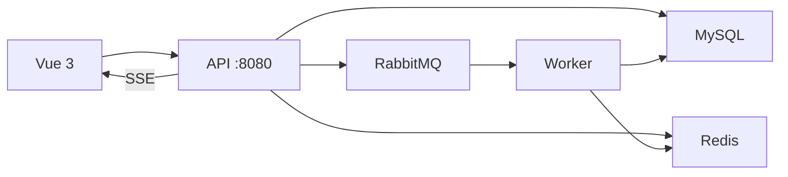

# Feed

本项目是对 [LeoninCS/feedsystem_video_go](https://github.com/LeoninCS/feedsystem_video_go) 的模仿实现，用来学习整套技术栈。模块划分、接口形状和异步链路都跟着原项目走，不是另行设计的系统。

## 技术栈

- 后端：Go、Gin、GORM、MySQL、Redis、RabbitMQ
- 前端：Vue 3、Vite、TypeScript、Pinia、axios

浏览器请求打到 API 进程。写操作把事件放进 RabbitMQ，由 Worker 进程异步落库，再通过 SSE 把通知推回浏览器。Redis 或 RabbitMQ 不可用时，API 降级为直接读写 MySQL，进程不退出。



API 和 Worker 是两个进程。点赞请求只负责入队并返回；Worker 停了，点赞接口仍然可以降级直写。

## 快速开始

依赖：Go 1.26.1、Node.js、Docker Desktop。MySQL、Redis、RabbitMQ 可以本机安装，也可以用下面的 Compose。

### Docker

在仓库根目录：

```powershell
docker compose up -d --build
curl.exe http://localhost:8080/healthz
```

`healthz` 返回 `{"status":"ok"}`。MySQL 映射在宿主机 **3307**，Redis 是 6379，RabbitMQ 是 5672，管理页是 `http://localhost:15672`。容器内的地址写在 `backend/configs/config.docker.yaml`，主机名是服务名 `mysql`、`redis`、`rabbitmq`。

默认口令在 `.env.example`。要改口令时复制成仓库根目录的 `.env`，不要把真密码提交进 Git。

当前 `backend/Dockerfile` 的基础镜像走 `docker.m.daocloud.io`，因为本机访问 `auth.docker.io` 会超时。网络能直连 Docker Hub 时，把两行 `FROM` 改回 `golang:1.26.1` 和 `alpine:3.21`。

启动前先确认宿主机的 8080、6379、5672 没有被别的进程占用。`docker compose down` 会停掉容器并保留数据；加上 `-v` 会删掉数据库和上传文件。

前端不在 Compose 里，仍在本机启动：

```powershell
cd frontend
npm install
npm run dev
```

浏览器打开 `http://localhost:5173`。Vite 把 `/api` 转发到 `http://127.0.0.1:8080` 并去掉前缀。

### 本机直接跑

MySQL、Redis、RabbitMQ 已在本机启动时：

```powershell
cd backend
go run ./cmd
go run ./cmd/worker
```

API 读 `backend/configs/config.yaml`（没有这个文件就用代码里的本地默认值）。Worker 连不上 RabbitMQ 会退出。

## 接口

除 `GET /healthz` 和 `GET /notification/stream` 外都是 POST，JSON 体。错误体是 `{"error":"..."}`。

鉴权：🔓 公开，🔐 请求头 `Authorization: Bearer <token>`，🔶 可匿名，带了 token 就必须合法。

| 方法 | 路径 | 鉴权 |
| --- | --- | --- |
| GET | `/healthz` | 🔓 |
| POST | `/account/register` | 🔓 |
| POST | `/account/login` | 🔓 |
| POST | `/account/refresh` | 🔓 |
| POST | `/account/changePassword` | 🔓 |
| POST | `/account/findByID` | 🔓 |
| POST | `/account/findByUsername` | 🔓 |
| POST | `/account/getProfile` | 🔓 |
| POST | `/account/logout` | 🔐 |
| POST | `/account/rename` | 🔐 |
| POST | `/account/uploadAvatar` | 🔐 |
| POST | `/account/updateProfile` | 🔐 |
| POST | `/video/uploadVideo` | 🔐 |
| POST | `/video/uploadCover` | 🔐 |
| POST | `/video/publish` | 🔐 |
| POST | `/video/getDetail` | 🔓 |
| POST | `/video/listByAuthorID` | 🔓 |
| POST | `/video/chunk/init` | 🔐 |
| POST | `/video/chunk/upload` | 🔐 |
| POST | `/video/chunk/status` | 🔐 |
| POST | `/video/chunk/complete` | 🔐 |
| POST | `/feed/listLatest` | 🔶 |
| POST | `/feed/listLikesCount` | 🔶 |
| POST | `/feed/listByPopularity` | 🔶 |
| POST | `/feed/listByTag` | 🔶 |
| POST | `/feed/listByFollowing` | 🔐 |
| POST | `/like/like` | 🔐 |
| POST | `/like/unlike` | 🔐 |
| POST | `/like/isLiked` | 🔐 |
| POST | `/like/listMyLikedVideos` | 🔐 |
| POST | `/comment/publish` | 🔐 |
| POST | `/comment/listAll` | 🔓 |
| POST | `/comment/delete` | 🔐 |
| POST | `/social/follow` | 🔐 |
| POST | `/social/unfollow` | 🔐 |
| POST | `/social/getCounts` | 🔐 |
| POST | `/social/getAllFollowers` | 🔐 |
| POST | `/social/getAllVloggers` | 🔐 |
| POST | `/message/send` | 🔐 |
| POST | `/message/list` | 🔐 |
| POST | `/notification/list` | 🔐 |
| POST | `/notification/markRead` | 🔐 |
| POST | `/notification/unreadCount` | 🔐 |
| GET | `/notification/stream` | 🔐 |
| POST | `/notification/delete` | 🔐 |

`/notification/stream` 是 SSE，token 可以放在查询参数 `?token=`。`/notification/delete` 是在原项目清单之外补上的删除通知。

Postman 集合在 `backend/test/postman.json`，导入后先跑 register、login。登录脚本会把 token 写入集合变量。

上传的视频、封面和头像落在 `.run/uploads`，通过 `/static/...` 访问。这些文件不要提交。
